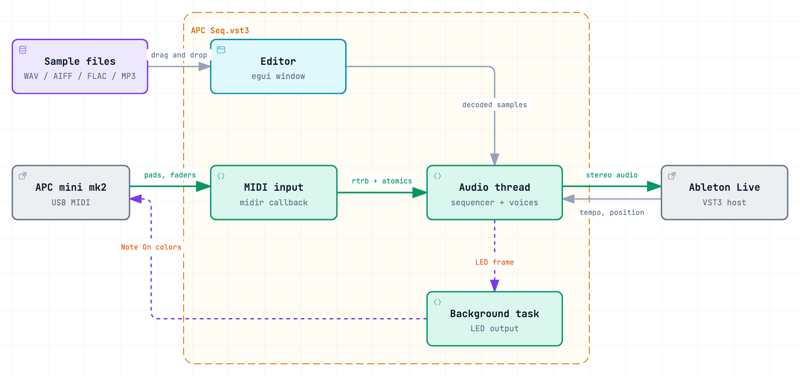

[English](ARCHITECTURE.md) | **Русский**

# Как устроен APC Seq

Этот документ — для тех, кто хочет менять плагин. Как его установить и на нём играть, написано в [README](../README.ru.md).

<picture>
  <source media="(prefers-color-scheme: dark)" srcset="images/architecture-dark.png">
  
</picture>

## Потоки и данные

- **MIDI-вход** (поток колбэка `midir`) слушает порт Control у APC. Нажатия падов и кнопок уходят в очередь без блокировок (`rtrb`), положения фейдеров — в атомарные переменные.
- **Аудио-поток** в начале каждого блока разбирает нажатия, берёт у хоста темп и позицию и на каждом сэмпле проверяет, не начался ли новый шаг 1/16. Поэтому удары попадают точно в сэмпл. Он смешивает до 32 голосов с линейной интерполяцией, так что сэмпл с любой частотой дискретизации звучит в правильной высоте.
- **Окно** (egui) декодирует аудиофайлы через `symphonia` и передаёт готовые сэмплы аудио-потоку через вторую очередь.
- **Фоновая задача** отправляет кадр подсветки на контроллер — только изменившиеся пады — и освобождает заменённые сэмплы, чтобы аудио-поток никогда не освобождал память сам.

Пути к сэмплам сохраняются в проекте хоста через поля `#[persist]` из NIH-plug и подгружаются в `initialize`. Паттерн живёт только в `Sequencer` аудио-потока и не сохраняется.

## Почему так устроено

- **Плагин общается с контроллером напрямую, а не через Live.** Live не передаёт MIDI CC в VST3-плагины, поэтому фейдеры не доходили. Ноты падов через дорожку оказались ненадёжны: после повторного добавления плагина они перестали приходить. Чтение порта через `midir` работает независимо от маршрутизации дорожки.
- **У плагина всё равно объявлен MIDI-вход, который он игнорирует.** Без него Live не загружает инструмент: `plugin has instrument category, but no valid event input bus`. Ноты с этого входа отбрасываются намеренно: если читать и их, каждое нажатие сработает дважды и переключение шага отменит само себя.
- **Подсветка и освобождение сэмплов выполняются фоновой задачей.** Отправка MIDI и освобождение памяти небезопасны для реального времени; аудио-поток только собирает 64-байтный кадр и ставит его в очередь.
- **Диалог выбора файла открывается в отдельном потоке.** Если открыть его прямо из отрисовки egui, macOS во время модального цикла вызывает отрисовку повторно, паника роняет плагин, а с ним и Live.
- **`egui-baseview` лежит в репозитории** в [`vendor/egui-baseview`](../vendor/egui-baseview). `baseview` уже сообщает о перетаскивании файлов на macOS и Windows, но исходный `egui-baseview` эти события отбрасывал. Копия передаёт их в egui как `hovered_files` / `dropped_files`; `Cargo.toml` подменяет зависимость через `[patch]`.
- **Громкость фейдера сглаживается на каждом сэмпле** (однополюсный фильтр, 10 мс) и идёт по квадратичной кривой, поэтому резкое движение не щёлкает.

## Структура репозитория

```
src/
  lib.rs          плагин: цикл обработки, синхронизация с транспортом, сглаживание фейдеров, фоновые задачи
  sequencer.rs    паттерн, раскладка сетки, цвета подсветки
  apc.rs          протокол APC mini mk2: номера нот и CC, палитра, midir вход и выход
  voice.rs        воспроизведение сэмплов, 32 голоса
  sample.rs       декодирование WAV / AIFF / FLAC / MP3 через symphonia
  editor.rs       окно egui: слоты сэмплов, перетаскивание, диалог выбора файла
vendor/egui-baseview/   egui-baseview с передачей перетаскиваемых файлов
xtask/                  сборщик бандла NIH-plug (cargo xtask)
bundler.toml            имя бандла: "APC Seq"
docs/diagrams/          исходник и интерактивная схема archify
```

## Протокол контроллера

| Элемент | MIDI |
| --- | --- |
| Пады | ноты 0–63 на канале 1; нота 0 — левый нижний пад, 63 — правый верхний |
| Кнопки под сеткой | ноты 100–107 |
| Кнопки справа | ноты 112–119 |
| Фейдеры | CC 48–56 на канале 1 |
| Цвет пада | Note On на ноту пада по каналу 7 (`0x96`, полная яркость), velocity — номер цвета в палитре |
| Подсветка кнопки | Note On по каналу 1, velocity 0 — выкл, 1 — вкл |

Плагин открывает порт, в имени которого есть `APC mini mk2`, нет `Notes` и который не начинается с `MIDIIN` или `MIDIOUT`: на macOS это `APC mini mk2 Control`, на Windows — первый из двух портов контроллера.

## Релизная сборка

В релизах лежит universal-бандл (Apple Silicon + Intel), из сообщений паник которого убраны локальные пути, с ad-hoc-подписью:

```bash
rustup target add x86_64-apple-darwin
export CARGO_ENCODED_RUSTFLAGS="$(printf -- '--remap-path-prefix=%s=/cargo\x1f--remap-path-prefix=%s=/apc-mini-step-sequencer' "$HOME/.cargo" "$PWD")"
cargo xtask bundle-universal apc_seq --release
codesign --force --deep -s - "target/bundled/APC Seq.vst3"
```

`CARGO_ENCODED_RUSTFLAGS` разделяет флаги символом `\x1f`, а не пробелом, поэтому пути с пробелами не ломаются. Бандл не заверен Apple; пользователи снимают флаг карантина командой `xattr`, как написано в README. В архив релиза также входят текст GPLv3 и лицензия MIT.

## Тесты

```bash
cargo test --lib
```

Тесты проверяют секвенсор: раскладку шагов на пады и обратно и переключение шагов у выбранной дорожки. Тайминг, звук и работа с контроллером проверяются вручную в Live.

## Схемы

Интерактивная схема — [`diagrams/architecture.html`](diagrams/architecture.html), собрана из [`diagrams/architecture.json`](diagrams/architecture.json) с помощью [archify](https://github.com/tt-a1i/archify). PNG в `images/` — её скриншоты в светлой и тёмной теме. Пересобрать HTML из корня репозитория:

```bash
node <path-to-archify>/bin/archify.mjs deliver architecture \
  docs/diagrams/architecture.json docs/diagrams/architecture.html --quality showcase
```
